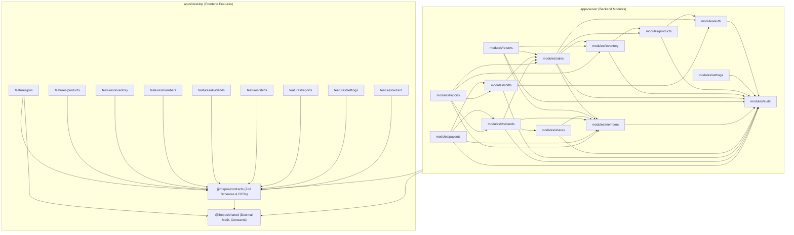

# MODULE DEPENDENCIES & COUPLING MAP
## แผนผังความเชื่อมโยงระหว่างโมดูล

เอกสารนี้แสดงการพึ่งพากันระหว่างโมดูล (Module Dependency Graph) เพื่อให้มั่นใจว่าการออกแบบเป็นไปตามหลัก Modular Architecture โดยไม่มีการเกิด Circular Dependency หรือการเชื่อมโยงข้ามขอบเขตอย่างไม่เหมาะสม

---

## 1. แผนผังการพึ่งพาของระบบ (Dependency Graph)

---

## 2. กฎเกณฑ์การจัดลำดับการพัฒนาและการประกอบโมดูล (Dependency Rules)

1. **ระดับฐานราก (Foundation Layer)**:
   - `@thepos/shared` และ `@thepos/contracts` จะต้องถูกสร้างขึ้นก่อนโมดูลอื่นเสมอ
2. **โมดูลแกนหลักด้านการตรวจสอบสิทธิ์ (Core Auth & Audit)**:
   - `modules/auth` และ `modules/audit` เป็นพื้นฐานที่ทุกโมดูลต้องเรียกใช้เพื่อตรวจสอบสิทธิ์และบันทึกประวัติ
3. **โมดูลสินค้าและคลัง (Catalog & Inventory)**:
   - `modules/products` ต้องพร้อมก่อน `modules/inventory` เพราะล็อตสินค้า (Stock Lots) ต้องผูกโยงกับข้อมูลสินค้า
4. **โมดูลการขาย (Sales & POS)**:
   - `modules/sales` พึ่งพา `products`, `inventory`, `members` และ `auth` เพื่อประมวลผลการตัดล็อตสินค้าและบันทึกยอดสะสมสมาชิกอย่างครบวงจร
5. **โมดูลการเงินและปันผล (Dividends & Payouts)**:
   - `modules/dividends` จะประมวลผลได้ต่อเมื่อมีข้อมูล `sales` (สำหรับคำนวณเงินเฉลี่ยคืนยอดซื้อ) และ `shares` (สำหรับคำนวณเงินปันผลตามหุ้น) อย่างสมบูรณ์
