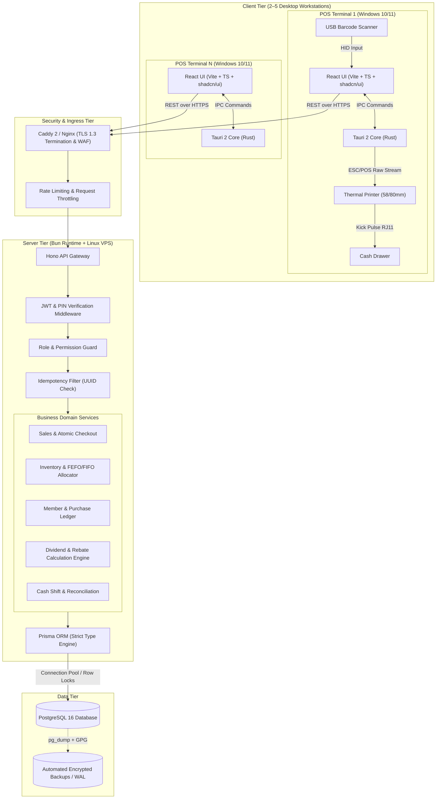
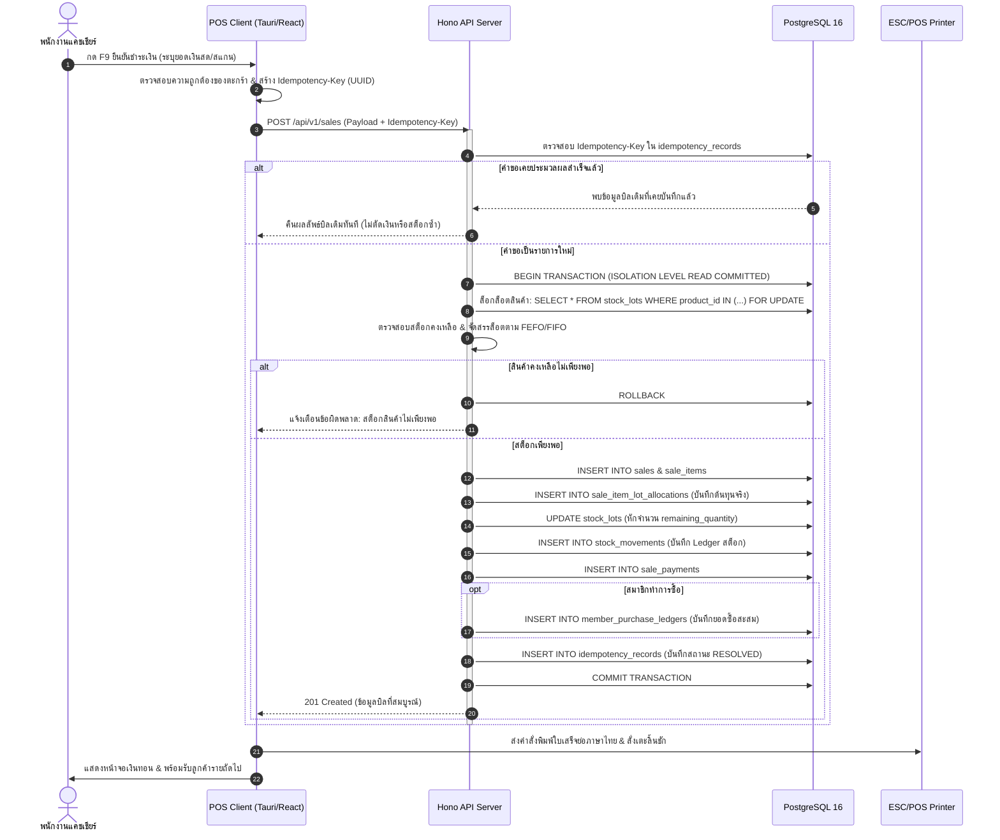

# SYSTEM ARCHITECTURE DOCUMENT
## สถาปัตยกรรมระบบโดยสมบูรณ์

---

## 1. ภาพรวมสถาปัตยกรรมระดับสูง (High-Level Architecture)

ระบบถูกออกแบบในรูปแบบ **Client-Server Architecture** โดยมี Desktop POS Application ติดตั้งที่เครื่องหน้าร้าน เชื่อมต่อผ่านเครือข่ายปลอดภัย (HTTPS / TLS 1.3) ไปยัง Centralized API Server และ PostgreSQL 16 Database บน VPS หรือระบบคลาวด์

---

## 2. ส่วนประกอบทางเทคนิคและหน้าที่ (Technical Components)

### 2.1 Desktop Client (Tauri 2 + React)
- **Tauri 2 (Rust Backend)**:
  - จัดการ Window Management, Native Menus, Deep Links
  - ควบคุมการสื่อสารกับพอร์ตฮาร์ดแวร์ (USB/Serial ESC/POS Thermal Receipt Printer)
  - เก็บข้อมูล Credentials และ Device Token อย่างปลอดภัยใน Windows Credential Manager
- **React UI**:
  - สร้างด้วย Vite + TypeScript สไตล์ Light Mode เน้นสี Dark Navy Blue
  - **Zustand**: จัดการ Client UI State เฉพาะที่ (ตะกร้าสินค้าปัจจุบัน, แท็บบิลที่กำลังเปิด, ข้อมูลกะปัจจุบัน)
  - **TanStack Query**: จัดการ Server State Caching, Background Refresh, และ Optimistic UI Updates
  - **React Hook Form + Zod**: ตรวจสอบความถูกต้องของแบบฟอร์มฝั่งไคลเอนต์ตามสัญญา API (`@thepos/contracts`)

### 2.2 Central API Server (Bun + Hono)
- **Bun Runtime**: ประมวลผล TypeScript ในระดับเนทีฟ มีความเร็วสูง ใช้ทรัพยากรต่ำ เหมาะสำหรับการรันไมโครเซอร์วิสหรือเซิร์ฟเวอร์แบบเบา
- **Hono Framework**: ทำหน้าที่เป็น API Gateway และ Router มี Middleware ที่ครอบคลุม:
  - `cors`: ควบคุมโดเมนต้นทางที่อนุญาต
  - `rateLimit`: ป้องกันการเดารหัสผ่านและ Brute-force โจมตี
  - `auth`: ตรวจสอบ JWT Bearer Token และ Device Token
  - `rbac`: ตรวจสอบสิทธิ์แบบ Granular Role-Based Permissions
  - `idempotency`: สกัดกั้นคำขอชำระเงินซ้ำซ้อนผ่าน Unique Request Key
  - `audit`: บันทึกข้อมูลการเปลี่ยนแปลงลงใน Audit Log ตลอดเวลา

### 2.3 Database Layer (PostgreSQL 16 + Prisma)
- **PostgreSQL 16**: รองรับ ACID Transactions เต็มรูปแบบ, Row-Level Pessimistic Locks (`FOR UPDATE`), Check Constraints และ Foreign Key Constraints
- **Prisma ORM 6.x**: บริหารจัดการ Database Schema, Versioned Migrations และเป็น Query Builder ที่รับประกันความปลอดภัยต่อ SQL Injection

---

## 3. ขอบเขตโมดูลระบบ (Module Boundaries)

| โมดูล (Module) | ขอบเขตความรับผิดชอบ (Responsibilities) | โมดูลที่ต้องพึ่งพา (Dependencies) |
|---|---|---|
| **Auth & RBAC** | จัดการผู้ใช้, รหัสผ่าน Argon2id, PIN ผู้จัดการ, เซสชัน, อุปกรณ์ POS | Core Database |
| **Products** | สินค้า, บาร์โค้ด, หมวดหมู่, อัตราทดหน่วยนับ, ข้อมูลราคา | Auth |
| **Inventory** | ล็อตสินค้า, วันหมดอายุ, การรับสินค้า, การตัดสต็อก FEFO/FIFO, ตรวจนับสต็อก | Products, Suppliers |
| **Sales** | การขายหน้าร้าน, ตะกร้าสินค้า, การชำระเงิน, การตัดสต็อกแบบ Atomic, พักบิล | Inventory, Products, Members, Auth |
| **Returns** | การคืนสินค้าอ้างอิงบิลเดิม, คืนสต็อกเข้าล็อต, ปรับปรุงยอดขายและยอดซื้อ | Sales, Inventory, Members |
| **Members & Shares** | ทะเบียนสมาชิก, ยอดซื้อสะสม, บัญชีหุ้น, รายการเคลื่อนไหวหุ้น | Core Database, Sales |
| **Dividends** | งวดบัญชี, กฎการปันผล, คำนวณเงินปันผลตามหุ้น, คำนวณเงินเฉลี่ยคืนยอดซื้อ, ล็อกผลอนุมัติ | Members, Sales, Shares |
| **Payouts** | บันทึกการจ่ายเงินปันผล/เฉลี่ยคืน, จ่ายเงินสด/โอน, ติดตามยอดคงค้าง | Dividends, Members, Shifts |
| **Shifts** | เปิด-ปิดกะแคชเชียร์, เงินทอนเริ่มต้น, บันทึกเงินเข้าออก, กระทบยอดเงินสดขาด/เกิน | Auth, Sales, Payouts |
| **Reports** | รายงานสถิติยอดขาย, กำไรขั้นต้นตามล็อตสินค้า, สต็อกคงคลัง, ประวัติการปันผล | All Data Modules |
| **Audit** | เก็บบันทึกประวัติการเปลี่ยนแปลงข้อมูลสำคัญอย่างไม่สามารถลบล้างได้ | All Data Modules |

---

## 4. กลยุทธ์ความสมบูรณ์ของธุรกรรม (Transaction Integrity Strategy)

---

## 5. การจัดการสถาปัตยกรรมเมื่อออฟไลน์ (Offline vs Online Boundary)

- **Version 1.0 (Current)**: ทำงานในรูปแบบ **Online-Only** หากเครือข่ายหลุด เครื่องลูกข่ายจะแจ้งเตือนสถานะขาดการเชื่อมต่ออย่างชัดเจน และไม่อนุญาตให้กดยืนยันการขาย เพื่อป้องกันปัญหาข้อมูลสต็อกไม่ตรงกัน
- **Version 2.0 (Future-Proof Design)**: สถาปัตยกรรมถูกออกแบบให้เตรียมพร้อมสำหรับ Local SQLite Cache โดยแยก Contracts และ DTOs ไว้อย่างชัดเจนใน `@thepos/contracts` ทำให้ในอนาคตสามารถติดตั้ง Sync Worker บนฝั่ง Desktop Client ได้อย่างราบรื่น
