# ENTITY RELATIONSHIP DIAGRAM (ERD)
## แผนผังความสัมพันธ์ฐานข้อมูลและคำอธิบายตาราง

---

## 1. แผนภาพความสัมพันธ์ระดับ Bounded Contexts (ERD Diagram)

```mermaid
erDiagram
    STORES ||--o{ USERS : employs
    STORES ||--o{ DEVICES : registers
    STORES ||--o{ SYSTEM_SETTINGS : configures
    USERS ||--o{ USER_ROLES : assigned
    ROLES ||--o{ USER_ROLES : grants
    ROLES ||--o{ ROLE_PERMISSIONS : contains
    PERMISSIONS ||--o{ ROLE_PERMISSIONS : defines
    USERS ||--o{ SESSIONS : establishes
    USERS ||--o{ CASH_SHIFTS : conducts
    USERS ||--o{ APPROVAL_REQUESTS : initiates
    USERS ||--o{ APPROVAL_DECISIONS : authorizes

    CATEGORIES ||--o{ PRODUCTS : categorizes
    PRODUCTS ||--o{ PRODUCT_BARCODES : identifies
    PRODUCTS ||--o{ PRODUCT_UNIT_CONVERSIONS : multiplies
    SUPPLIERS ||--o{ GOODS_RECEIPTS : delivers
    GOODS_RECEIPTS ||--o{ STOCK_LOTS : supplies
    PRODUCTS ||--o{ STOCK_LOTS : groups
    STOCK_LOTS ||--o{ STOCK_MOVEMENTS : tracks
    STOCK_LOTS ||--o{ STOCK_ADJUSTMENTS : adjusts

    SALES ||--o{ SALE_ITEMS : includes
    PRODUCTS ||--o{ SALE_ITEMS : references
    SALE_ITEMS ||--o{ SALE_ITEM_LOT_ALLOCATIONS : consumes
    STOCK_LOTS ||--o{ SALE_ITEM_LOT_ALLOCATIONS : deducts
    SALES ||--o{ SALE_PAYMENTS : settles
    MEMBERS ||--o{ SALES : buys
    MEMBERS ||--o{ MEMBER_PURCHASE_LEDGERS : accumulates
    SALES ||--o{ MEMBER_PURCHASE_LEDGERS : creates

    SALES ||--o{ SALE_RETURNS : refunds
    SALE_RETURNS ||--o{ SALE_RETURN_ITEMS : reverses
    SALE_ITEMS ||--o{ SALE_RETURN_ITEMS : references

    MEMBERS ||--o{ SHARE_ACCOUNTS : owns
    SHARE_ACCOUNTS ||--o{ SHARE_TRANSACTIONS : records

    ACCOUNTING_PERIODS ||--o{ DIVIDEND_RUNS : calculates
    DIVIDEND_RULES ||--o{ DIVIDEND_RUNS : applies
    DIVIDEND_RUNS ||--o{ DIVIDEND_RESULTS : outputs_share
    DIVIDEND_RUNS ||--o{ PURCHASE_REBATE_RESULTS : outputs_rebate
    DIVIDEND_RUNS ||--o{ PAYOUT_OBLIGATIONS : creates
    MEMBERS ||--o{ PAYOUT_OBLIGATIONS : owes
    PAYOUT_OBLIGATIONS ||--o{ PAYOUT_ALLOCATIONS : settles
    PAYOUTS ||--o{ PAYOUT_ALLOCATIONS : groups
    MEMBERS ||--o{ PAYOUTS : receives

    CASH_SHIFTS ||--o{ CASH_MOVEMENTS : records
    USERS ||--o{ AUDIT_LOGS : performs
```

---

## 2. นิยาม Bounded Contexts หลัก

### 2.1 Core, Authentication & Devices
- **`stores`**: ข้อมูลสาขาร้านค้าสหกรณ์ ข้อมูลผู้เสียภาษี ที่อยู่ การตั้งค่าใบเสร็จ และสถานะภาษีมูลค่าเพิ่ม
- **`users`**: ผู้ใช้งานระบบ บันทึกรหัสผ่านและ PIN ที่ผ่านการแฮชด้วย Argon2id พร้อมระบบล็อกบัญชีอัตโนมัติเมื่อกรอกผิดเกิน 5 ครั้ง
- **`roles` & `permissions`**: สิทธิ์การใช้งานระบบแยกตามบทบาท (`ADMIN`, `MANAGER`, `CASHIER`, `STOCK_STAFF`) และสิทธิ์เฉพาะกิจ
- **`devices`**: เครื่อง POS แต่ละเครื่องที่ได้รับอนุญาตเชื่อมต่อกับระบบเพื่อความปลอดภัย
- **`sessions`**: บันทึกโทเคนการเข้าใช้งานและสถานะการเพิกถอนสิทธิ์ (Revocation)

### 2.2 Products & Inventory
- **`products`**: สินค้า รหัส SKU หมวดหมู่ ราคาต้นทุน ราคาขายทั่วไป และราคาขายสำหรับสมาชิกสหกรณ์
- **`product_barcodes`**: บาร์โค้ดประจำสินค้า รองรับ 1 สินค้ามีหลายบาร์โค้ด
- **`product_unit_conversions`**: อัตราทดหน่วยนับ (เช่น 1 ลัง = 24 ชิ้น)
- **`stock_lots`**: ล็อตสินค้า วันหมดอายุ ราคาต้นทุนจริงต่อล็อต และจำนวนคงเหลือ มีข้อกำหนด `CHECK (remaining_quantity >= 0)`
- **`stock_movements`**: สมุดบัญชีบันทึกการเคลื่อนไหวสต็อกสินค้าทุกประเภท ตรวจสอบย้อนหลังได้ตลอดเวลา

### 2.3 Sales, Checkout & Returns
- **`sales`**: บิลการขาย เลขที่เอกสารเรียงตามลำดับ ยอดรวม ส่วนลด ยอดภาษี และ `idempotency_key`
- **`sale_items`**: รายการสินค้าในบิล พร้อมบันทึกภาพถ่ายราคาและส่วนลดขณะทำรายการ
- **`sale_item_lot_allocations`**: บันทึกการตัดสต็อกจากล็อตจริงและราคาต้นทุนจริงของแต่ละชิ้น (FEFO/FIFO)
- **`sale_payments`**: บันทึกการรับชำระเงิน (เงินสด, QR โอนเงิน, การแยกชำระ)
- **`held_sales`**: ตะกร้าสินค้าที่พักบิลไว้ชั่วคราว
- **`sale_returns` & `sale_return_items`**: รายการคืนสินค้าอ้างอิงบิลเดิมและการคืนสต็อก

### 2.4 Members, Shares & Dividends
- **`members`**: ทะเบียนสมาชิกสหกรณ์ ข้อมูลติดต่อ และเลขประจำตัวประชาชนที่เข้ารหัส
- **`member_purchase_ledgers`**: สมุดบัญชียอดซื้อสะสมที่เข้าเกณฑ์ได้รับเงินเฉลี่ยคืน
- **`share_accounts` & `share_transactions`**: บัญชีหุ้น จำนวนหุ้นที่ถือครอง และประวัติการเคลื่อนไหวหุ้น
- **`accounting_periods`**: งวดบัญชีสหกรณ์และสถานะการปิดงวด (`APPROVED_LOCKED`)
- **`dividend_rules`**: แม่แบบสูตรการคำนวณเงินปันผลตามหุ้นและเงินเฉลี่ยคืนตามยอดซื้อ
- **`dividend_runs`**: บันทึกประวัติการสั่งประมวลผลการคำนวณ
- **`dividend_results`**: ผลการคำนวณเงินปันผลตามหุ้นรายสมาชิก
- **`purchase_rebate_results`**: ผลการคำนวณเงินเฉลี่ยคืนตามยอดซื้อรายสมาชิก
- **`payout_obligations` & `payouts`**: ภาระผูกพันการจ่ายเงินและประวัติการจ่ายเงินจริง
